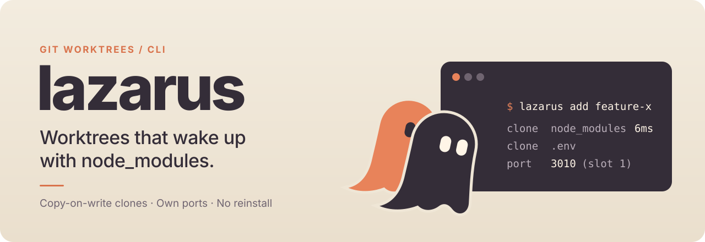

<p align="center">
  
</p>

<p align="center">Git worktrees that are ready to run, without a second copy of <code>node_modules</code>.</p>

<p align="center">
  <a href="https://www.npmjs.com/package/lazarus">npm</a> ·
  <a href="#get-started">Get started</a> ·
  <a href="docs/how-it-works.md">How it works</a>
</p>

<p align="center">
  macOS (APFS) · Linux (Btrfs, XFS) · Node 20 or later<br>
  <a href="https://github.com/NikAtNight/lazarus/actions/workflows/test.yml"></a>
</p>

A git worktree gives you a second checkout of a branch, but it starts empty.
Before it runs, you install every package again. `lazarus add` creates the
worktree and fills it with copy-on-write clones of the main checkout's
`node_modules` folders and `.env` files instead. A clone shares disk blocks with
the original until one side changes, so it costs almost nothing.

Each worktree also gets its own block of ports. Five agents can work on five
branches of one repo, and each can run its own dev server.

## Get started

```sh
npm install -g lazarus
```

1. Install the main checkout's packages as usual. lazarus clones what's there.
2. From anywhere in the repo, run `lazarus add feature-x`. It creates `../<repo>-feature-x` on a new branch.
3. In the new worktree, run `lazarus run -- pnpm dev`. The server gets the worktree's port in `PORT`.
4. When you're done, `lazarus rm feature-x` stops its servers and removes it.

## How fast

Each row starts from a shallow clone of a public repo with its packages already
installed and a warm package cache. The median of three runs on an M5 Pro Mac
(APFS). Disk is the drop in free space, so it includes the checked-out source.

| Repo | Package manager | `node_modules` | Worktree + install | `lazarus add` |
| --- | --- | --- | --- | --- |
| [excalidraw](https://github.com/excalidraw/excalidraw) | yarn | 857 MB | 5.7s, 967 MB | **1.2s, 79 MB** |
| [nest](https://github.com/nestjs/nest) | npm | 540 MB | 3.8s, 590 MB | **1.2s, 38 MB** |
| [astro](https://github.com/withastro/astro) | pnpm | 1.3 GB | 7.2s, 127 MB | 6.5s, 108 MB |
| [vite](https://github.com/vitejs/vite) | pnpm | 722 MB | 1.7s, 49 MB | 2.0s, 44 MB |
| [elysia](https://github.com/elysiajs/elysia) | bun | 122 MB | 0.3s, 46 MB | 0.4s, 48 MB |

npm and yarn put a full copy of every package in each checkout, so that's where
lazarus saves the most. pnpm and bun already link packages from a shared store,
so a plain worktree is cheap and lazarus about ties it. With those, what you get
from lazarus is the ports, the `.env` files, and `rm`.

Installs ran with `--ignore-scripts`, and nest needed `--legacy-peer-deps`.

## Commands

| Command | What it does |
| --- | --- |
| `lazarus add <branch> [path]` | Create a worktree and clone `node_modules` and `.env` files into it. Checks out `<branch>` if it exists, else creates it from `--base` or `HEAD`. `--no-install` skips the install when lockfiles differ. |
| `lazarus list` | Show every worktree with its branch, port, and whether a server answers there. |
| `lazarus rm <branch\|path>` | Stop the worktree's servers, remove it, and delete its branch if it's merged. Refuses uncommitted changes unless you pass `--force`. |
| `lazarus run -- <command>` | Run a command with this worktree's port in `PORT`, and `@port` through `@port+9` filled in. |
| `lazarus dev` | Run the `dev` command from `lazarus.json` on this worktree's port. |
| `lazarus port` | Print this worktree's first port. |
| `lazarus hydrate` | Clone into a worktree that something else created, like an editor. |

```
   BRANCH         PORT  SERVER  PATH
   main           3000  -       /code/app
*  feat-login     3010  up      /code/app-feat-login
```

## Ports

Every checkout owns a block of 10 ports. The main checkout starts at 3000, the
first worktree at 3010, the next at 3020. `lazarus run` puts the first one in
`PORT` and replaces placeholders in the command:

```sh
lazarus run -- pnpm dev                              # Next.js reads PORT
lazarus run -- pnpm dev --port @port --strictPort    # Vite ignores PORT
lazarus run -- env API_PORT=@port+1 pnpm dev:api     # a second server
```

It refuses to start when something already listens on the worktree's port.

lazarus hands each worktree its own ports, but the project has to use them.
Three things broke in testing with several instances running:

- **A hardcoded proxy target.** `proxy: { '/api': 'http://127.0.0.1:4680' }` sends every worktree's API calls to one server. Read the port from the environment: `` `http://127.0.0.1:${process.env.API_PORT ?? 4680}` ``.
- **A fixed `port` in a config file.** It wins over `PORT`. Pass `@port` on the command line instead.
- **Shared services.** Cloned `.env` files are identical, so every worktree uses the same external database and API keys. A database file inside the repo isn't cloned unless you list it in `clone`.

## Settings

Put a `lazarus.json` in the main checkout. Every worktree reads that one file, so
changes apply right away. All keys are optional:

```json
{
  "port": 5173,
  "dev": "pnpm dev --port @port",
  "clone": ["data"],
  "hardlink": false
}
```

| Key | Meaning |
| --- | --- |
| `port` | First port of the main checkout's block. Default 3000. |
| `dev` | Shell command for `lazarus dev`, with the same placeholders as `run`. |
| `clone` | Extra git-ignored paths to clone into new worktrees, like a local database folder. |
| `hardlink` | On a disk that can't clone, hard-link npm and yarn packages instead of copying them. See [disks that can't clone](docs/how-it-works.md#disks-that-cant-clone). |

## Limits

- It needs a copy-on-write disk to share space: APFS, Btrfs, or XFS. On others, pnpm and bun repos install and npm and yarn repos copy.
- `du` counts a clone at full size. Compare `df` before and after to see what a worktree costs.
- Native build output inside `node_modules`, such as Xcode `.DerivedData`, keeps the main checkout's paths.
- Stopping only the process on a port can leave a watcher like `tsx watch` running. Stop the `lazarus run` process, or use `lazarus rm`.

## Read more

- [How it works](docs/how-it-works.md): what gets cloned, when it installs, disks that can't clone, and ports.

## License

MIT. See [LICENSE](LICENSE).
